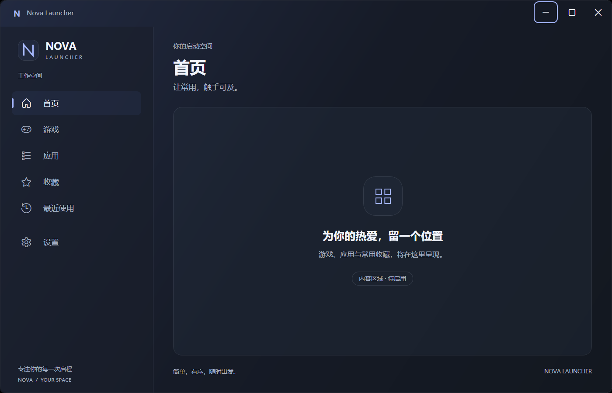

# Nova Launcher — UI 设计

## 第三阶段范围

已实现 Windows 11 Minimal Glass UI 基础外壳：自定义标题栏、可调整大小的主窗口、六项左侧导航和右侧内容占位。导航只改变选中态与内容标题，不加载页面数据，不执行应用启动、收藏、历史记录或设置业务。

## 布局与窗口

- 默认窗口 1120 × 720 DIP，最小 800 × 560 DIP。
- 标题栏高 48 DIP；通过 WPF WindowChrome 保留原生拖动、双击最大化、系统菜单及边缘缩放行为，自定义最小化、最大化/还原和关闭按钮。
- 标题栏下方使用 1*:3* 的 Grid 列比例，侧栏随窗口保持约 25%，右侧约 75%。不使用固定 200 DIP 宽度。
- 左侧包含品牌区、工作空间标签、首页、游戏、应用、收藏、最近使用、设置及底部品牌说明。导航项为 Fluent 字体小图标与文字，单行高 44 DIP，选中态同时显示色块和左侧标记。
- 六个入口在最小窗口下全部可见；保留垂直滚动能力，避免未来内容或字体变更后入口不可达。
- 右侧显示当前导航标题与静态内容占位，不呈现虚构应用卡片、计数、搜索或按钮。内容边距为 36 / 28 / 36 / 32 DIP。

窗口框架参考 [Microsoft WindowChrome 文档](https://learn.microsoft.com/en-us/dotnet/api/system.windows.shell.windowchrome?view=windowsdesktop-9.0)。窗口操作留在 MainWindow 的纯视图事件中，ViewModel 不接触 WPF Window。

## 视觉资源

颜色与控件模板集中在 NovaLauncher.App/Themes/ShellTheme.xaml，通过 App.xaml 合并加载。

| 语义 | 当前值 |
| --- | --- |
| 实色底层 WindowBrush | #11141C |
| 背景渐变 BackdropBrush | #222A41 → #161B27 → #131820 |
| 侧栏 SidebarBrush | #99191E29 |
| 内容表面 SurfaceBrush | #66242C3D |
| 细描边 BorderBrush | #24C4D1EC |
| 主文字 / 次文字 | #F2F5FC / #A8B3C7 |
| 强调色 | #A6B8FF |
| 主内容圆角 / 导航圆角 | 16 / 8 DIP |
| 字体 | Microsoft YaHei UI，回退 Segoe UI |
| 图标字体 | Segoe Fluent Icons，回退 Segoe MDL2 Assets |
| 内容标题 / 导航文字 | 30 / 14 DIP |
| Hover 时长 | 160 ms，EaseOut |

文字与图标保持不透明；半透明侧栏、表面、描边和 Hover 层在应用内叠加。窗口本身保持不透明，不设置整个窗口 Opacity，也不启用 AllowsTransparency。本阶段完成半透明设计准备，尚未调用系统 Acrylic/Mica 或桌面背景模糊 API，不将渐变背景称为原生 Mica。

## 交互与可访问性

- 鼠标悬停导航与标题栏按钮时，HoverFeedback 对独立反馈层执行淡入淡出，不改变布局位置或尺寸。关闭按钮使用红色反馈。
- 点击导航或通过键盘上下键选择，只更新 SidebarViewModel.SelectedItem；ContentView 绑定 Sidebar.SelectedItem.Name。
- Tab 焦点可见；导航保留选中指示，标题栏图标按钮提供工具提示、可访问名称与 AutomationId；最大化后切换为“还原”名称和图标。
- ShellPreferences 监听系统动画及高对比度设置。关闭动画时将后续 Hover 过渡时长设为 0；高对比度使用系统画刷覆盖视觉资源，保留即时状态反馈。
- 高对比度和系统动画开关已实现适配，本次没有改动用户系统设置来执行实机切换测试。多显示器混合 DPI、100% / 150% / 200% 缩放仍待专项验证。

## ui-ux-pro-max 使用记录

读取已安装 SKILL.md，执行 desktop launcher dark glass minimal 的 design-system 检索，以及 WPF 资源样式与 glassmorphism dark 定向检索。

首次整体验索返回 Hero / CTA 网页布局和浅色方案，与桌面启动器不匹配，未采用或保存为设计系统。后续玻璃风格检索匹配 Glassmorphism；采用其细描边、分层表面、清晰对比和克制动效建议。实现采用 WPF ResourceDictionary 和 MVVM，不引入 CSS、Web 字体服务或前端框架。来源版本见 [SkillIntegration.md](SkillIntegration.md)。

## 实际验证与截图

2026-10-14，在 Windows 11、本机 125% DPI、SDK 9.0.318 / WindowsDesktop Runtime 9.0.20 下：

- Release 构建通过，0 警告、0 错误。
- 实际窗口验证六项导航、内容标题绑定与键盘方向键切换。
- 验证标题栏原生拖动命中区域，以及自定义最大化、还原、最小化、关闭按钮；关闭后退出码为 0。
- 验证默认与最小尺寸的 25% 侧栏比例、六个入口可见性，检查正常与 Hover 状态截图。
- 截图为真实应用窗口，不包含桌面或其他应用；本机 125% 缩放下默认截图为 1400 × 900 像素，最小尺寸为 1000 × 700 像素。

复现：先构建 Release，再执行 `powershell.exe -NoProfile -ExecutionPolicy Bypass -File scripts/Test-UiShell.ps1`。脚本会启动并操作本次测试窗口、保存截图并关闭进程。

[Hover 状态](screenshots/launcher-shell-hover.png) · [最小窗口](screenshots/launcher-shell-small.png)

后续阶段再确定真实 Mica/Acrylic 实现、应用卡片和业务页面，不在本阶段扩展。
