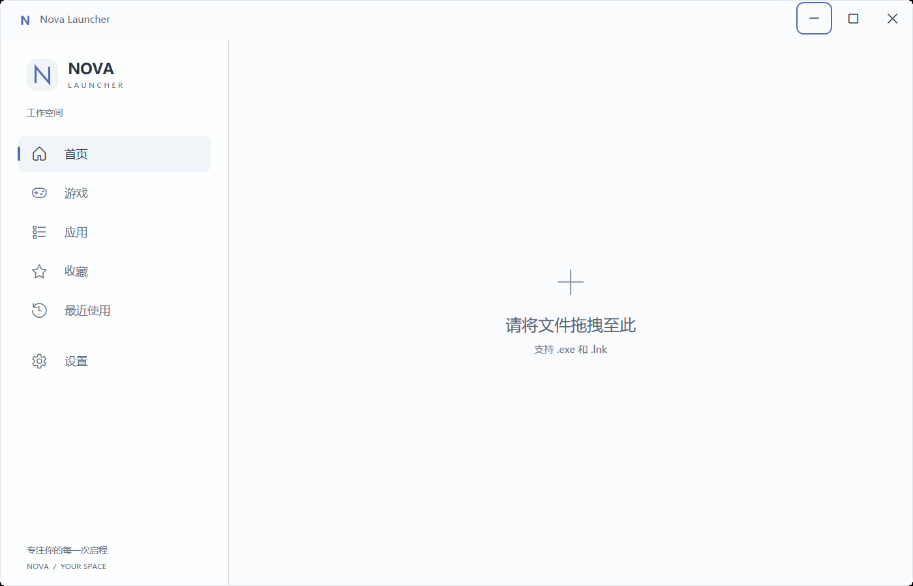
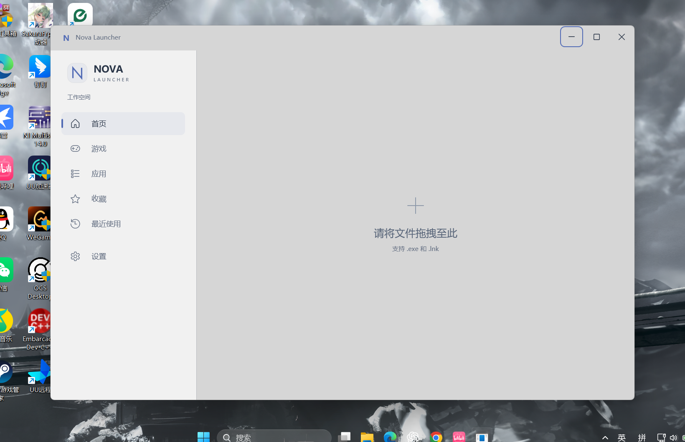

# Nova Launcher — UI 设计

## 3.2 收尾：稳定 UI Shell，Desktop Backdrop 为 Experimental

当前采用 Windows 11 Minimal Light Glass UI：保留左侧 Logo、六个导航入口、小图标与文字、选中标记和 Hover 动画；右侧改为占满可用空间的 Application Launcher Workspace。本轮只修改 UI Shell，不实现文件拖入、应用启动、文件解析、图标提取、SQLite 或用户系统。

本轮按用户收尾授权提交第三阶段全部 UI Shell 修改；不继续尝试透明 API，不开发业务功能。

## 窗口与侧栏

- 默认窗口 1120 × 720 DIP，最小 800 × 560 DIP，继续使用 WindowChrome；标题栏高 48 DIP。
- 标题栏保留最小化、最大化/还原、关闭按钮，以及原生拖动和双击最大化/还原行为。
- 内容布局初始使用 1*:3* 星号列宽，侧栏默认约 25%。窄窗口下优先满足 210 DIP 最小宽度，因此比例可能略高于 25%。DIP 是 WPF 逻辑像素，125% 缩放下 210 DIP 对应约 263 个物理像素。
- 侧栏右边缘增加 8 DIP 宽的 GridSplitter 命中区域，默认显示轻描边，Hover/聚焦时强调分隔线；支持鼠标拖动和键盘左右键微调。
- SidebarColumn.MinWidth 为 210，MaxWidth 随主布局宽度更新为 35%。拖动后继续使用星号列宽，窗口缩放时重新约束，不把侧栏改为完全固定宽度；本轮不持久化用户调整。
- 侧栏布局未重构，六个导航项与品牌区保留；3.2 删除底部宣传文字，保留空白供未来用户区使用。导航仍只修改 MVVM 选中状态，右侧不再显示导航标题。

列调整方式参考 [WPF GridSplitter 文档](https://learn.microsoft.com/en-us/dotnet/desktop/wpf/controls/how-to-resize-columns-with-a-gridsplitter)。列宽限制属于视图布局逻辑，不进入 ViewModel。

## Application Launcher Workspace

右侧取消原 Dashboard 的顶部介绍、页面标题、底部标语、品牌文字和中央矩形卡片。整个右侧区域作为未来应用图标容器，四周只保留 24 DIP 留白。

空状态在右侧中央显示极简加号与两行文字：

- 主文字：请将文件拖拽至此
- 辅助文字：支持 .exe 和 .lnk

这两行仅用于视觉预览，没有启用 AllowDrop 或任何拖放事件，不表示已经实现格式支持。

## 原生材质与实际结果

采用官方 DwmSetWindowAttribute 的 DWMWA_SYSTEMBACKDROP_TYPE（38），请求 DWMSBT_TRANSIENTWINDOW（3）。Windows 11 将其定义为 Desktop Acrylic，最低支持 build 22621；选择它是为了采样窗口后面的内容，Mica 的壁纸色调融合不能代替桌面透视。

配合 DwmExtendFrameIntoClientArea 的完整玻璃区域、WindowChrome.GlassFrameThickness=-1 和透明 WPF CompositionTarget。不降低 Window.Opacity，不启用 AllowsTransparency，不增加 NuGet。使用 Windows 10/11 兼容性应用清单，保留现有自定义标题栏。

**2026-10-15 实际截图未通过视觉验收：Windows 11 build 26200 上 DWM 返回成功，查询材质值为 3，但 Workspace 仍显示均匀灰色，无法看到壁纸。不能将 API 状态 DesktopAcrylic 解释为视觉生效。** 红蓝背后窗口探针也未透出，不能把原因直接归咎于动态壁纸。尝试的未公开 AccentPolicy 路径同样未通过，已移除，不作为交付实现。根因仍待定位。

背景分层保持：原生 DWM → ShellBackgroundView（fallback 或原生白色覆盖层）→ 较不透明的 Sidebar → 清晰文字/图标。MainWindow 不包含材质分支，布局未重设计。

## 回退与扩展入口

DesktopBackdropController 在不支持的 Windows、关闭 UI 视觉效果/透明效果、高对比度、远程会话、节能、窗口失活、DWM 调用失败或读取偏好失败时，先恢复不透明浅色背景，再禁用原生材质。监听窗口激活、状态变化、系统设置、主题、显示和电源通知，条件恢复后重新请求材质。系统自身也可能覆盖材质效果；成功的 HRESULT 不能检测所有实际渲染问题。

| BackgroundMode | 当前行为 / 入口 |
| --- | --- |
| Desktop（默认） | 请求原生 Desktop Acrylic；不满足条件时使用 BackgroundFallbackBrush |
| CustomImage | 仅保留模式与输入契约，暂不实现图片呈现，使用 SolidColor fallback |
| SolidColor | 保留 SolidBackground（Brush）输入，无输入则 fallback |

仅 Desktop 接入平台实现。没有图片选择、设置保存或业务功能。NOVA_DISABLE_SYSTEM_BACKDROP=1 为进程级诊断开关，可验证安全回退而不更改用户系统设置。

官方依据：[DWM_SYSTEMBACKDROP_TYPE](https://learn.microsoft.com/en-us/windows/win32/api/dwmapi/ne-dwmapi-dwm_systembackdrop_type)、[DwmExtendFrameIntoClientArea](https://learn.microsoft.com/en-us/windows/win32/api/dwmapi/nf-dwmapi-dwmextendframeintoclientarea)、[Acrylic 材质行为](https://learn.microsoft.com/en-us/windows/apps/design/style/acrylic)。

## 视觉参数

资源集中于 Themes/ShellTheme.xaml。

| 语义 | 值 |
| --- | --- |
| WindowBrush / BackgroundFallbackBrush | #F9FAFC |
| fallback 白色遮罩 GlassTintBrush | #A6FFFFFF |
| 原生材质覆盖层 NativeGlassTintBrush | #D9FFFFFF |
| 侧栏 SidebarBrush | #A8FFFFFF |
| 边框 BorderBrush | #18344058 |
| 主文字 TextBrush | #283446 |
| 次文字 MutedTextBrush | #657083 |
| 空状态文字 / 加号 | #586579 / #8A96A7 |
| 强调色 AccentBrush | #526BB5 |
| Active / Hover | #14617FC2 / #0F324F88 |
| 窗口圆角 / 导航圆角 | 12 / 8 DIP |
| Workspace 留白 | 24 DIP |
| 导航行高 / 字号 | 44 / 14 DIP |
| Hover 时长 | 160 ms，EaseOut；系统关闭动画时为 0 |

继续保留清晰键盘焦点、按钮可访问名称、系统高对比度资源适配。浅色主题是当前默认方向，深色主题不再是本阶段约束。

## 技能使用与验证

已阅读 AGENTS.md、项目工作规范和已安装的 ui-ux-pro-max SKILL.md，执行 light glass 的设计检索和 glassmorphism / WPF resizable 定向检索。通用设计结果中的 Hero / CTA 网页结构不适合启动器，未采用；采用玻璃表面分层、文字对比、轻边框，以及 Star + MinWidth/MaxWidth 的布局建议。没有生成新的网页设计系统或新增依赖。

2026-10-14，Windows 11、125% DPI、SDK 9.0.318：

- Release build：0 warnings、0 errors。
- 实际启动窗口，确认 Workspace 仅有指定两行文字；六项导航及键盘选择正常。
- 实际鼠标拖动 GridSplitter，确认宽度发生变化，并验证 210 DIP 下限、35% 上限和方向键微调。
- 检查标题栏原生拖动命中、双击最大化/还原、自定义最小化/最大化/还原/关闭；最大化后关闭按钮位于显示器工作区内，关闭进程退出码为 0。
- 检查默认、Hover、侧栏拉宽和最小窗口截图；最小窗口六个入口完整可见，空状态保持居中。
- 未测试真实原生背景、用户背景图片、混合 DPI、多显示器或实际切换系统高对比度；这些不作为本轮完成声明。

复现：先 Release build，再执行 `powershell.exe -NoProfile -ExecutionPolicy Bypass -File scripts/Test-UiShell.ps1`。脚本会操作本次测试窗口、保存截图、关闭进程并恢复鼠标位置。

[Hover](screenshots/launcher-shell-3.1-hover.png) · [侧栏拉宽](screenshots/launcher-shell-3.1-wide.png) · [最小窗口](screenshots/launcher-shell-3.1-small.png)

## 3.2 验证记录

Windows 11 build 26200、125% DPI、.NET SDK 9.0.318：Release build 0 warnings / 0 errors。原生请求与强制 fallback 两条运行路径均通过导航、最小化、最大化/还原、标题栏双击、窗口调整大小、实际鼠标拖动侧栏（210 DIP 至 35%）以及关闭退出检查。没有新增依赖；该轮验证时未提交，后续收尾授权见下文。

强制 fallback 的 DWM 值为 1，界面保持浅色且可读；旧版 Windows、真实切换系统透明效果/高对比度、DWM HRESULT 失败、多显示器未实机测试，不宣称覆盖。桌面截图使用 CopyFromScreen，PrintWindow 不能证明 DWM 合成效果。

复现原生请求：`powershell.exe -NoProfile -ExecutionPolicy Bypass -File scripts/Test-UiShell.ps1 -DesktopCapture`。

复现回退：上述命令追加 `-ForceFallback`。脚本临时最小化其他窗口，结束后恢复。自动检查只验证 API 状态和交互；截图仍须检查，当时透视目标未通过；本轮按下述 Experimental 决策收尾，不再以壁纸透视作为 UI Shell 完成条件。

[强制 fallback 实拍](screenshots/launcher-desktop-3.2-fallback.png)
## 3.2 最终收尾决策

Desktop Backdrop 状态正式定义为 **Experimental**。Windows DWM API 已经接入，但在当前 WPF 自定义窗口环境下尚未可靠呈现桌面壁纸。保留 DesktopBackdropController、DwmSetWindowAttribute、DwmExtendFrameIntoClientArea、版本检测与 fallback。未来允许继续研究，但不得阻塞核心功能开发；本轮不尝试新透明 API。

BackgroundMode 固定为 Desktop / CustomImage / SolidColor。Desktop 默认尝试 Windows System Backdrop，调用失败或条件不支持时使用 SolidColorBackground；CustomImageBackground 暂不实现，仅预留扩展契约；SolidColorBackground 是稳定的浅白色 fallback。

fallback 基底统一为 #F9FAFC，继续叠加原白色表面。实验性 DWM 路径使用独立 #D9FFFFFF 白色覆盖层，避免 API 成功但系统呈灰色时出现大面积中灰。此覆盖层是可读性与稳定视觉处理，不意味着桌面透视已生效。Sidebar 保留 #A8FFFFFF 的额外白色表面，文字与图标保持清晰。未改变导航、Logo、图标、Workspace 布局、提示文案、窗口按钮或侧栏拖动行为。

收尾截图另存于 screenshots/final-3.2/，保留此前实验截图作为历史证据。
收尾验证：Release build 0 warnings / 0 errors；默认 Desktop 与强制 fallback 两条路径均通过现有 UI 回归，实际检查截图确认浅白 Surface 与原布局。技能入口已读取；本轮 Python 不可用，未新增技能数据库检索，颜色处理依据技能内置的浅色表面可读性、语义资源和对比建议。

[最终 Desktop 表面](screenshots/final-3.2/launcher-desktop-3.2.png) · [最终 SolidColor fallback](screenshots/final-3.2/launcher-desktop-3.2-fallback.png)