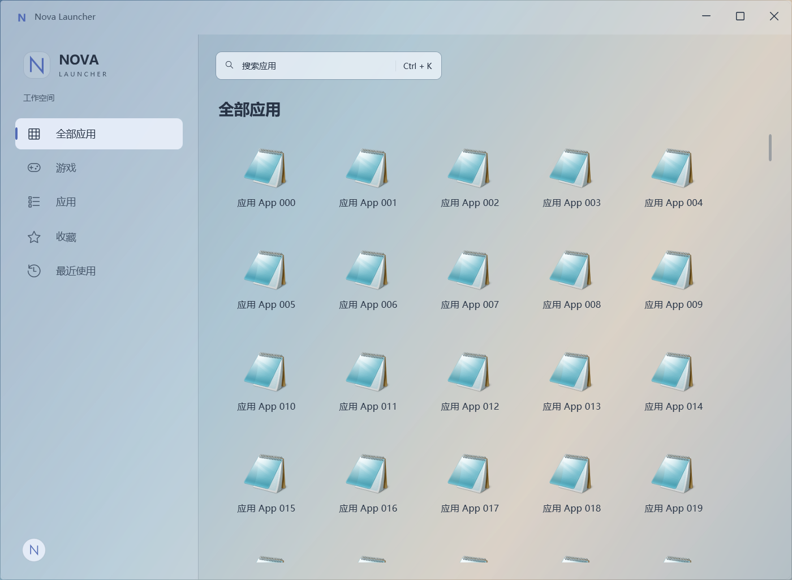
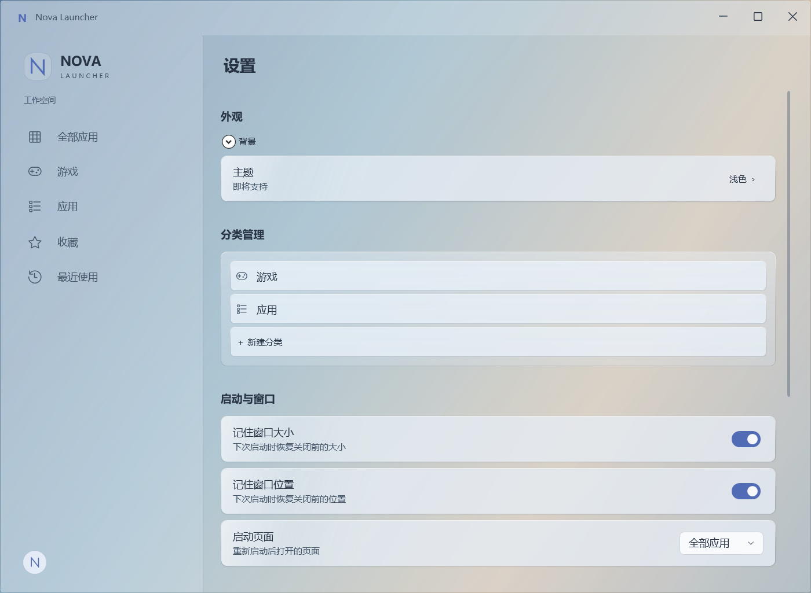
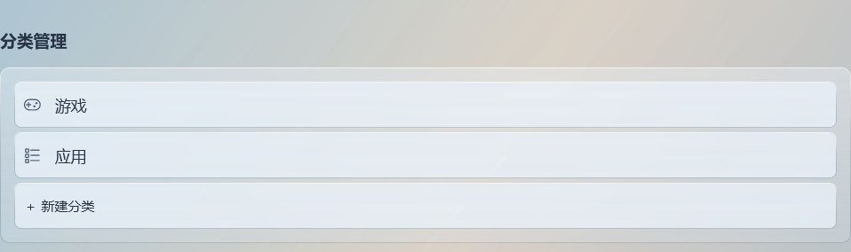
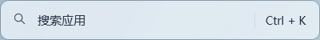
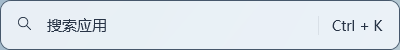
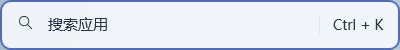
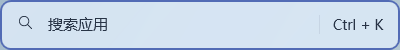

# 8.4.3 — Glass Integration Polish

2026-10-22 已通过用户最终验收，作为 Nova Preview Glass Mode 基线；已获指定提交授权。延续 8.4～8.4.2 的累计工作；本轮产品改动仅涉及五个 XAML 文件，未改 True Transparency、Window.Opacity、数据库、Migration、业务、搜索或性能架构。

## 最终收尾与范围确认

用户授权提交 `style: refine glass mode visual hierarchy`。提交包含 8.4～8.4.3 累计源码、验证工具、规范及截图，未混入无关修改。8.4 新增透明宿主及性能测量字段属于此前实现；8.4.3 未修改透明机制或 8.2 渐进渲染架构，不能将累计提交相对 8.3 的 diff 误称为仅五个 XAML。

最终 Release Build：**0 warnings / 0 errors**，日志 `artifacts/verification/8.4.3/closeout/build.log`。进入收尾时，所有快照文件均与上次交付 SHA-256 一致；本次收尾只更新文档，未修改产品或验证代码。

8.4.3 已通过的六组相关回归 231 项继续有效；本次补验 Favorites 31、Recent 22、Profile 44、Management / Context Menu 46，共 143 项，**本阶段相关回归合计 374 项**。透明专项另有 **28 项**，发布启动检查另有 **6 项**。此前 8.4.1 的 20 组 728 项完整回归中，其余未受影响项目沿用已有结果；不声称本次重跑全部 728 项。日志分别保存在本阶段根目录及 `closeout/`，原完整回归位于 `artifacts/verification/8.4.1/regression/`。

| 验收项 | 确认依据 |
| --- | --- |
| True Transparency / Window.Opacity | 透明宿主与服务在8.4.3前后哈希不变；实际窗口断言 Window.Opacity == 1，后窗及窗口移动可独立改变合成像素 |
| 数据库 / Migration | Persistence目录相对稳定基线无diff；实际模型 HasPendingModelChanges 为false；0 Schema Change、0新增Migration |
| 业务 / Search / Quick Launcher | 业务服务、搜索索引与QuickLauncherViewModel无diff；Quick Launcher 69项及透明全量集合搜索通过 |
| 8.2性能架构 | AllApplicationsView渐进渲染实现无diff；实际300张卡片无重复；只沿用历史测量，不新增性能结论 |
| All Applications / Category / Favorites / Recent / Settings | 对应26 / 34 / 31 / 22 / 44项回归通过 |
| Context Menu / Profile | Management 46 / Profile 44项通过，透明窗口下Shift+F10与Profile弹层通过 |
| Default / DesktopWallpaper / CustomImage / Glass | 外观39项、透明28项覆盖切换、窗口恢复、原静态壁纸/图片加载及失败回退 |

## 材质层级

资源集中在 `NovaLauncher.App/Themes/GlassMode.xaml`，使用同一组冷蓝灰色相，文字不参与透明度叠加。

| 层级 | 资源 | 作用 |
| --- | --- | --- |
| Window Base | GlassWindowBase、GlassChromeSurface | 约 9% 的整窗底色；标题栏和侧栏共用约 20% 的 Chrome 色，品牌区沿用轻透明底色。替代此前侧栏额外 55% 白色叠层。 |
| Workspace Tint | GlassWorkspaceSurface | 非均匀渐变，Alpha 为 95% → 72% → 86%，再乘用户保存的遮罩强度。边缘有光感，中部让背景色进入；不再用整窗纯白均匀幕布。 |
| Section / Panel | GlassPanelSurface、GlassCardSurface | 分类外容器约 42% → 25%；设置卡片约 85% → 71% → 76%，上缘更亮，主体透出背景色。 |
| Control / Input / Row | GlassInputSurface、GlassCategorySurface | 搜索常态约 79%，分类行约 75%；行项比外容器清楚。“新建分类”成为同宽、同圆角的列表末行。 |

设置卡片用 1 DIP 渐变细边框、上缘高光及 Opacity 0.07 / Depth 1 / Radius 6 的轻阴影体现浮层。降低板感同时保留局部阅读底面；没有新增背景模糊、捕获或合成机制。

页面标题 22 DIP / SemiBold，分组标题 15 DIP / SemiBold，设置行文本 14 DIP，描述 12 DIP；Glass 标题背景透明，主要靠间距和字重组织。次要文字加深到 #46576B。Quick Launcher、菜单、Toast、Profile 的高可读底面资源保留。

搜索仍为打开 Quick Launcher 的原按钮入口，输入和搜索行为不变。普通、Hover、Focus、Pressed 使用不同 Surface；Focus 有 2 DIP 强调色边框，快捷键与搜索图标、文案在同一底面中，并以细分隔线区分。

## 截图

以下为实际 Windows 合成屏幕截图，125% DPI。主图使用 40% 遮罩；另提供默认 72% 对照，不修改产品默认值或用户保存值。背景为独立的实时渐变测试窗口，用于重复比较材质，**不是用户桌面壁纸**，也未把背景图塞进 Nova。红蓝文字后窗的移动验证另有截图记录。

全部应用（Glass，40%）：



设置（Glass，40%）：



分类管理特写：



搜索普通 / Hover / Focus / Pressed：









默认强度对照：[全部应用 72%](screenshots/8.4.3/glass-all-applications-72.png)、[设置 72%](screenshots/8.4.3/glass-settings-72.png)。[展开背景设置](screenshots/8.4.3/transparent-settings.png)。

## 验证

- Release Build：0 warnings / 0 errors；`git diff --check` 无空白错误。
- 透明专项 28 项通过：包含原 25 项及真实指针 Hover、Pressed、独立键盘 Focus 三项。完整集合搜索、实时后窗移动、窗口移动、缩放、切换稳定模式和回退均通过。
- 受影响回归：全部应用 26、设置 44、外观 39、分类 34、Quick Launcher 69、视觉 19，共 231 项通过。
- Self-contained win-x64 验收包 StartupOnly Smoke 6 项通过，确认包内运行时、独立新库、单实例恢复、异常结束后重启和正式用户目录元数据未变。不是完整发布 Smoke 或 Clean Machine Test。
- 初次透明测试缺少隔离夹具的 performance.png，补齐后通过；初次发布启动检查缺 release-manifest.json，按现有发布契约补齐后通过。保留两次初始日志，未降低断言。
- 本轮未重跑性能矩阵；未宣称消除复杂文字后窗的所有干扰。多显示器/DPI与真实 Clean Machine Test 沿用未完成状态。

验证日志在 `artifacts/verification/8.4.3/`。截图入口：

```powershell
artifacts/build/8.4.3/NovaLauncher.Verification.exe --performance-seed artifacts/verification/8.4.3/fixture-300 300
artifacts/build/8.4.3/NovaLauncher.Verification.exe --performance-background artifacts/verification/8.4.3/fixture-300 12
artifacts/build/8.4.3/NovaLauncher.Verification.exe --glass-polish artifacts/verification/8.4.3/fixture-300 docs/screenshots/8.4.3
```

本轮相对于进入任务时的文件快照，只修改 `GlassMode.xaml`、`ShellTheme.xaml`、`ShellBackgroundView.xaml`、`ContentView.xaml`、`CategoryManagementView.xaml` 五个产品视图/资源文件，以及三个 Verification 文件和阶段文档。已有 8.4～8.4.2 改动全部保留。

验收包为本次聊天 outputs 下的 `NovaLauncher-8.4.3/NovaLauncher.exe`。运行前完全退出旧 Nova，避免单实例机制唤醒旧版本。版本号仍为 0.1.0-preview.1，8.4.3 为验收目录标识。未自动启动正式用户实例；最终提交按用户明确授权执行，不开始下一阶段。
