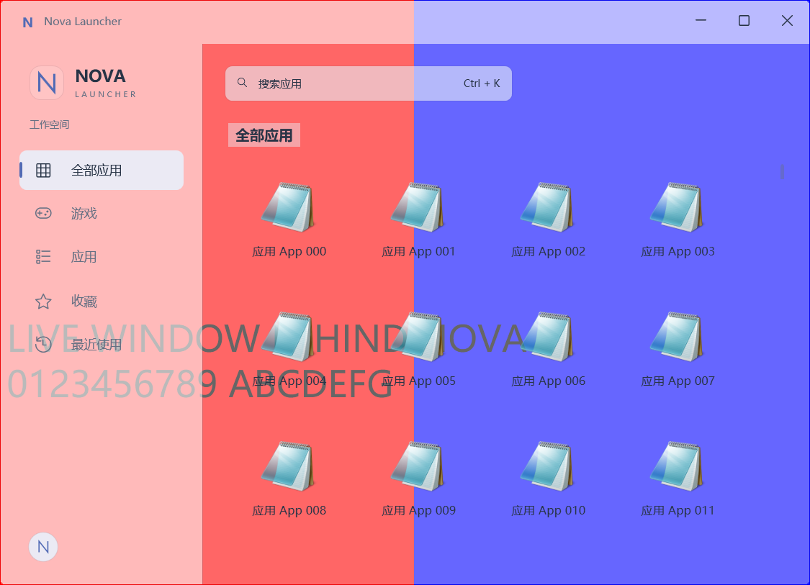
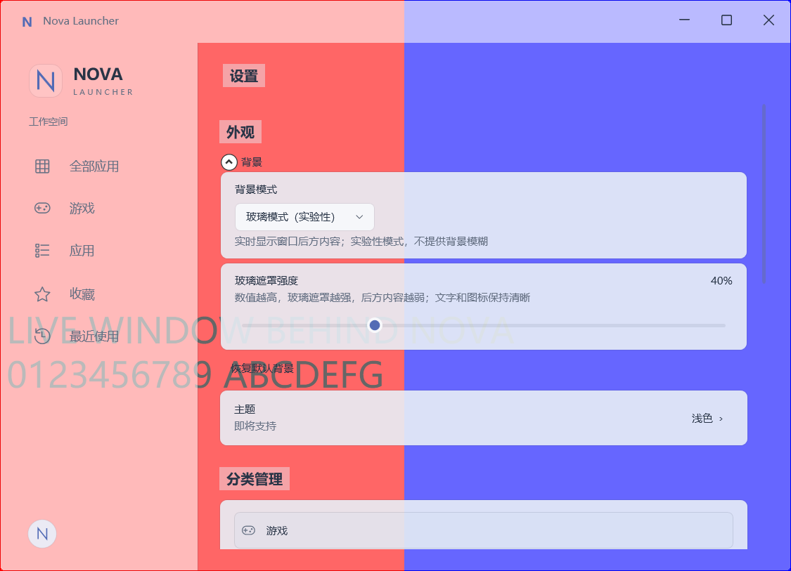
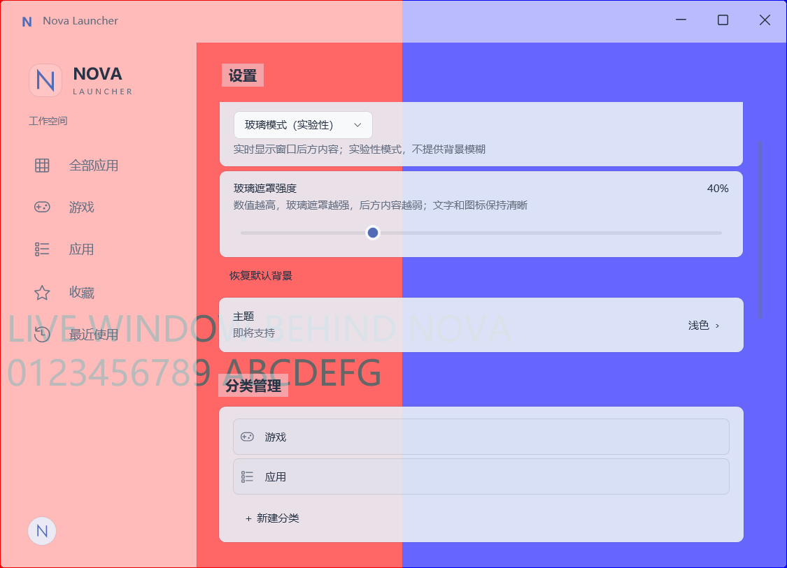
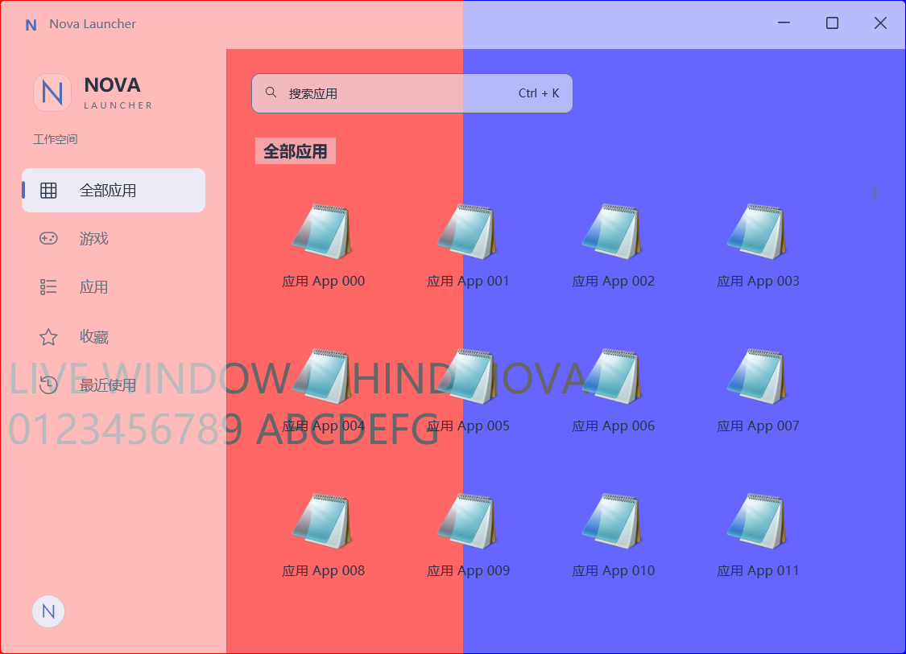

# 8.4.2 — Glass Surface Polish

在未提交的8.4/8.4.1工作上进行视觉收尾，不自动commit。透明机制、Window.Opacity、数据结构、Migration、应用业务、搜索及性能架构均不变。

## 变化

| 区域 | 8.4.1 | 8.4.2 |
| --- | --- | --- |
| 顶部搜索入口 | 复用98%浮层底色 | 专用60%浅冷灰Input Surface；Ctrl+K共享背景 |
| 全部应用/设置/Section标题 | 整行95%白色底面 | 45%浅冷灰局部标题底色，宽度贴合文字 |
| Settings页面层级 | Workspace标题与内部大标题重复 | 只保留Workspace标题，然后Section与卡片 |
| Settings卡片 | 95%接近白色 | 90%浅冷灰、轻边框，保持文字可读 |
| 分类管理 | 外层卡片内直接排列内容 | 外层玻璃卡，每个分类项有轻底色、细边界和内边距 |
| Sidebar品牌N | 复用90%Selected Surface | 专用约14%白色底色，避免独立白贴片 |

GlassInputSurface、GlassCardSurface、GlassCategorySurface、GlassBrandSurface、GlassSurfaceBorder新增到GlassMode.xaml；GlassHeadingSurface调整为局部低不透明底色。GlassElevatedSurface、GlassOverlaySurface、GlassSelectedSurface保留高可读交互层策略。未新增BlurEffect、Shader或捕获；“玻璃”仅描述现有实时合成与Surface，不代表本轮增加背景模糊。

Default、DesktopWallpaper、CustomImage仍使用原资源。本轮不调整Tint默认值或覆盖用户保存值。低Tint且后方文字复杂时仍可调高遮罩，不承诺无模糊玻璃在所有背景下都消除干扰。

## 验收截图

本轮截图统一使用40%Workspace Tint、125%DPI和真实独立红蓝文字后窗，方便观察材质差异。对比[8.4.1全部应用](screenshots/8.4.1/glass-all-applications.png)及[8.4.1设置](screenshots/8.4.1/transparent-settings.png)。

稳定模式对照：[Default](screenshots/8.4.2/default-all-applications.png)、[CustomImage](screenshots/8.4.2/custom-image-all-applications.png)。

## 验证范围

Release Build、透明专项、受影响的回归结果保存在`artifacts/verification/8.4.2`。本轮不重跑已完成的8.4.1性能矩阵，不把旧性能数字声称为本轮新测量。多显示器/DPI与真实Clean Machine Test继续未完成。

Release Build：0 warnings / 0 errors。透明专项25项通过；全部应用26、设置44、外观39、分类34、Quick Launcher69、视觉19，共231项相关回归通过。截图确认Default与CustomImage保留原材质；DesktopWallpaper切换由透明专项覆盖。沿用此前其他完整回归结果，不声称本阶段重跑728项。

发布到`artifacts/publish/self-contained-8.4.2/NovaLauncher.exe`，与原目录分开。原目录因运行中进程锁定WPF资源导致覆盖发布中断，已从8.4.1原ZIP仅恢复缺失文件，不终止用户进程。启动新包前应完全退出旧Nova，否则单实例机制会唤醒旧进程。Preview版本号仍为0.1.0-preview.1；8.4.2是验收目录标识。

最终独立包StartupOnly Smoke通过：复制包无数据库/日志/PDB、隔离新库启动成功、加载包内运行时、第二实例唤醒已有窗口、异常结束后重启、真实用户目录文件元数据未变。证据为`publish-versioned.log`与`publish-smoke.log`；这是启动范围检查，不是本轮完整发布Smoke或Clean Machine Test。
