# Nova Launcher 8.4 — 实时透明背景 / Windows Backdrop

## 8.4.3 最终 Glass 基线（已验收）

2026-10-22 用户通过最终验收，授权提交 `style: refine glass mode visual hierarchy`。本次提交包含基于 `3eaf6b8` 累积的 8.4～8.4.3 工作；8.4.3 本身仅优化视觉资源与布局，未重做 8.4 的 True Transparency。Window.Opacity 保持 1，0 Schema Change、0 新 Migration，应用业务、Search / Quick Launcher 和 8.2 渐进渲染架构不变。

### 最终材质层级

资源集中在 `NovaLauncher.App/Themes/GlassMode.xaml`，使用同一组冷蓝灰色相，文字不参与透明度叠加。

| 层级 | 资源 | 作用 |
| --- | --- | --- |
| Window Base | GlassWindowBase、GlassChromeSurface | 约 9% 的整窗底色；标题栏和侧栏共用约 20% 的 Chrome 色，品牌区沿用轻透明底色。替代此前侧栏额外 55% 白色叠层。 |
| Workspace Tint | GlassWorkspaceSurface | 非均匀渐变，Alpha 为 95% → 72% → 86%，再乘用户保存的遮罩强度。边缘有光感，中部让背景色进入；不再用整窗纯白均匀幕布。 |
| Section / Panel | GlassPanelSurface、GlassCardSurface | 分类外容器约 42% → 25%；设置卡片约 85% → 71% → 76%，上缘更亮，主体透出背景色。 |
| Control / Input / Row | GlassInputSurface、GlassCategorySurface | 搜索常态约 79%，分类行约 75%；行项比外容器清楚。“新建分类”成为同宽、同圆角的列表末行。 |

设置卡片用 1 DIP 渐变细边框、上缘高光及 Opacity 0.07 / Depth 1 / Radius 6 的轻阴影体现浮层。降低板感同时保留局部阅读底面；没有新增背景模糊、捕获或合成机制。

页面标题 22 DIP / SemiBold，分组标题 15 DIP / SemiBold，设置行文本 14 DIP，描述 12 DIP；Glass 标题背景透明，主要靠间距和字重组织。次要文字加深到 #46576B。Quick Launcher、菜单、Toast、Profile 的高可读底面资源保留。

搜索仍为打开 Quick Launcher 的原按钮入口，输入和搜索行为不变。普通、Hover、Focus、Pressed 使用不同 Surface；Focus 有 2 DIP 强调色边框，快捷键与搜索图标、文案在同一底面中，并以细分隔线区分。

Default / DesktopWallpaper / CustomImage 保持原模式；Glass 仍为可关闭、可回退的实验性模式。默认遮罩 72% 和已有保存值不变，40% 仅用于对照截图。Quick Launcher / Context Menu / Toast / Profile 保持高可读策略。完整截图与最终验证见 [8.4.3交付记录](GlassIntegration-8.4.3.md)。此前性能数据仍是历史测量，本次未重跑性能矩阵；Clean Machine Test 和多显示器/DPI 的既有未验证项不改写为已完成。不开始下一阶段。

## 8.4.1 Glass Mode 视觉统一

沿用8.4实时透明技术，只调整窗口局部Surface资源与视觉样式。“透明桌面（实验性）”更名为“玻璃模式（实验性）”，存储值Transparent不变；桌面壁纸仍是静态Windows壁纸。本节为历史视觉规范，当前以8.4.3为准，下文8.4的实心Sidebar/TitleBar描述及截图保留作前后比较。

TitleBar与Sidebar统一使用55%白色Chrome Surface叠加全局Tint；40%全局Tint时有效遮罩约73%，可以感知后窗且导航清晰。选中项90%浅蓝，保留Accent条；Hover和Settings Card约95%，标题95%局部底色；Quick Launcher、Context Menu及分类子菜单、Profile、Toast约98%。名称底色由实心白块改为透明Surface，卡片布局不变；空状态增加局部可读底色。保留轻量Scrollbar、1px边框及真正键盘Focus提示。

语义资源集中在`NovaLauncher.App/Themes/GlassMode.xaml`：GlassWorkspaceSurface、GlassChromeSurface、GlassElevatedSurface、GlassOverlaySurface、GlassLabelSurface、GlassSelectedSurface、GlassHeadingSurface。Transparent负责合成，Tokens负责可读性。资源只加载到透明窗口；Default、DesktopWallpaper、CustomImage保留原资源。回退同时移除玻璃资源。

未改变底层透明机制、窗口Opacity、数据库、Migration、应用业务、Search/Quick Launcher逻辑或渐进渲染架构；未增加Blur、Shader、VisualBrush或背景捕获。

**默认值决策**：40%作为本轮视觉验证值。持久化Overlay与图片模式共享，无法区分默认值与已有用户主动保存值，本轮保留72%默认和全部已保存设置，不强制重置。用户可用“玻璃遮罩强度”调整，值越高，后方内容越弱。复杂后窗仍可能干扰无卡片底板的应用名称，建议提高遮罩；第一版无背景模糊的限制仍在。

### 8.4.1性能与交付验证

所有Glass画刷显式Freeze，运行时确认`IsFrozen=True`；名称与Hover通过资源替换实现，不为每张卡片额外增加模式绑定。只调整资源，没有改动性能架构。最终同一300项夹具、1200×720窗口、同一已保存Tint，每组预热1次、正式5次中位数如下。

| 指标 | 8.4历史Transparent | 同期8.4视觉对照 | 8.4.1最终Glass |
| --- | ---: | ---: | ---: |
| 首屏 ms | 874.3 | 969.1 | 873.1 |
| Startup Ready ms | 3781.1 | 4154.6 | 4017.2 |
| 全300项完成 ms | 6833.8 | 7727.4 | 7235.5 |
| Scroll 30步 ms | 135.2 | 285.4 | 265.2 |
| Resize 20步 ms | 1147.2 | 1669.0 | 1560.7 |
| Resize CPU ms | 1187.5 | 2078.125 | 1687.5 |
| 全探针 CPU ms | 10437.5 | 12453.125 | 11437.5 |
| Managed bytes | 131772280 | 131991720 | 131993616 |
| Working Set bytes | — | 642387968 | 639397888 |

历史记录与本轮Scroll/Resize存在明显差异，故不能直接据历史数字判定本次Surface回退。同期对照为隔离复制的当前App，恢复8.4实白TitleBar/Sidebar、名称底色及原样式；保留相同合成机制、业务和探针。对照源码/包保存在ignored的`artifacts/verification/8.4.1/control-source`，不作为交付包。同期结果未观察到Glass造成进一步明显恶化；样本少且分组顺序执行，不宣称确定的性能提升。8.4的layered窗口Resize代价仍存在，不能声称已解决。

最终数据为`performance-frozen/300-1..5.json`，同期对照为`performance-control`。初版`performance`测得首屏886.1ms、Scroll354.9ms、Resize1657.8ms；去除额外卡片绑定后的`performance-final`为904.6/372.2/1858.1ms，均保留以解释复测原因，不能挑选其中最快一次作为交付结论。最终所有正式运行首批40、最终300，保持渐进渲染。

### 前后截图

本阶段Release Build为0 warnings / 0 errors；20组完整回归728项通过，透明真实窗口专项25项通过。导入套件首轮等待长名称Tooltip超时，未改测试或产品代码，单独复核37项通过；失败日志保留在`artifacts/verification/8.4.1/import-first-attempt.log`，最终各套件日志位于`regression`。没有重跑旧DWM原型或改动透明机制。多显示器/DPI和真实Clean Machine Test仍未完成。

最终冻结资源后再次通过25项透明专项及受影响的全部应用26项、外观39项、视觉19项，其余已通过回归沿用。透明测试曾因持久化Topmost=true未改变Z顺序，导致独立测试后窗挡住Nova，及原生Ctrl+K焦点等待超时；截图已确认遮挡，测试现先重新置顶并通过真实标题栏点击确认前台HWND，未降低断言或修改产品输入逻辑。失败日志保留为`live-focus-attempt.log`、`live-occluded-attempt.log`。

Self-contained发布包已重新生成，主要交付路径仍为`artifacts/publish/self-contained/NovaLauncher.exe`。本轮12项实际发布Smoke已通过；最终仅优化静态画刷后另对最终EXE执行隔离Glass启动检查，证据位于`published-glass`，不把单次启动检查计入性能中位数。完整发布Smoke日志为`publish-smoke.log`。不自动commit，待用户验收。

前：[8.4 全部应用](screenshots/8.4/transparent-before.png)、[8.4 Settings](screenshots/8.4/transparent-settings.png)。后如下；均为真实独立后窗，不是产品背景截图。8.4旧Settings截图为80% Tint，本轮为40%，不能把全部差异归因于Surface调整。

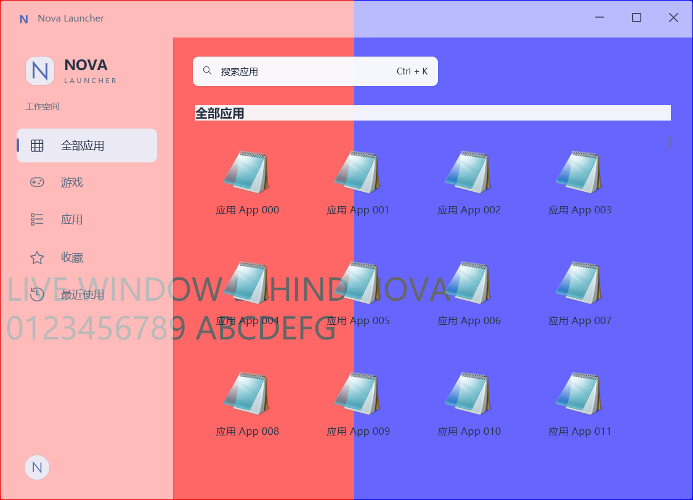

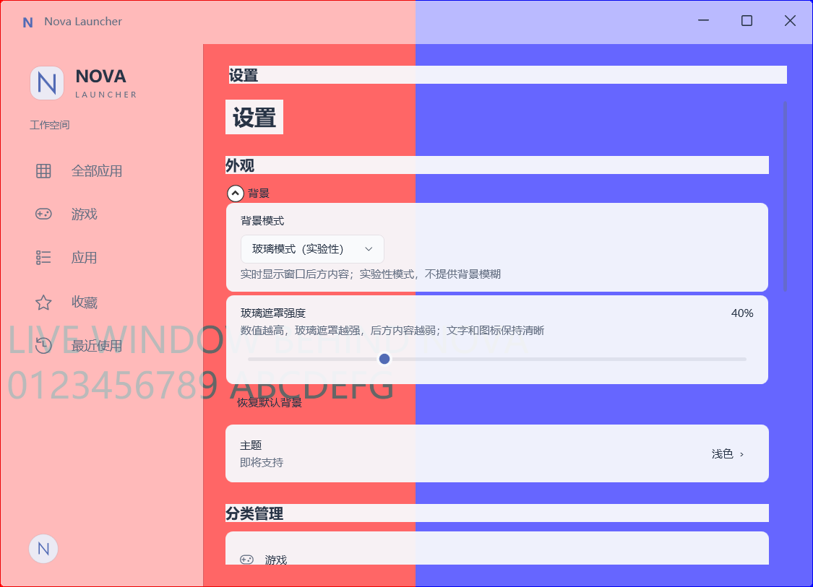

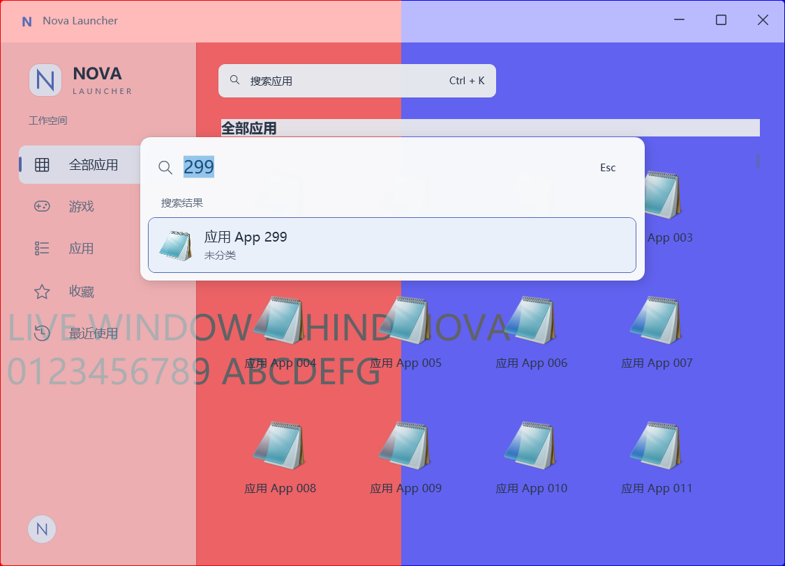

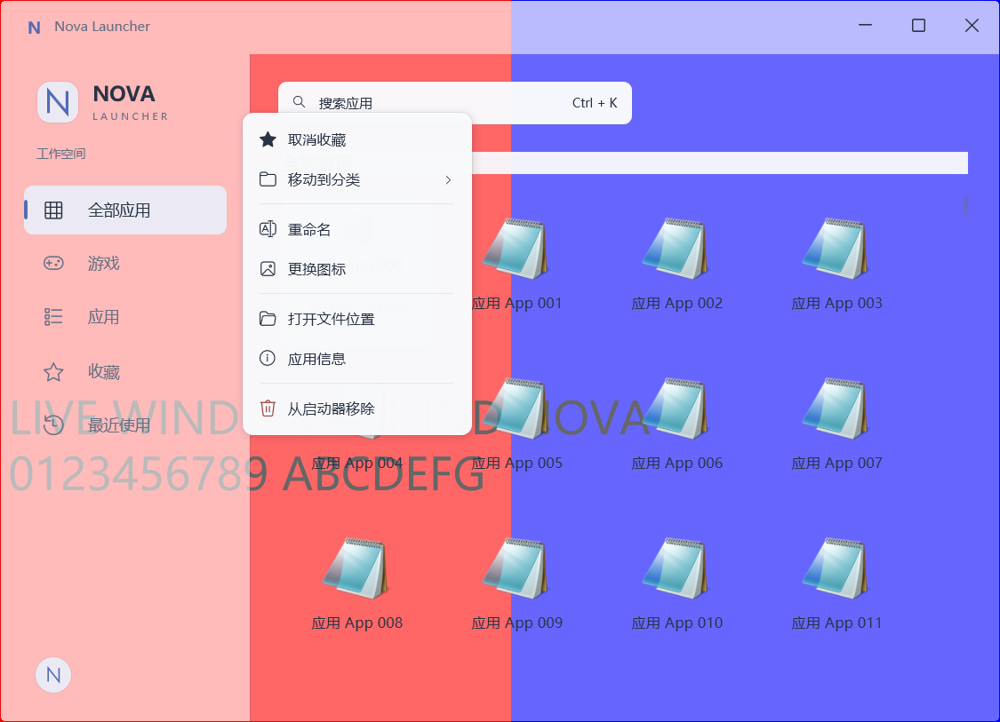

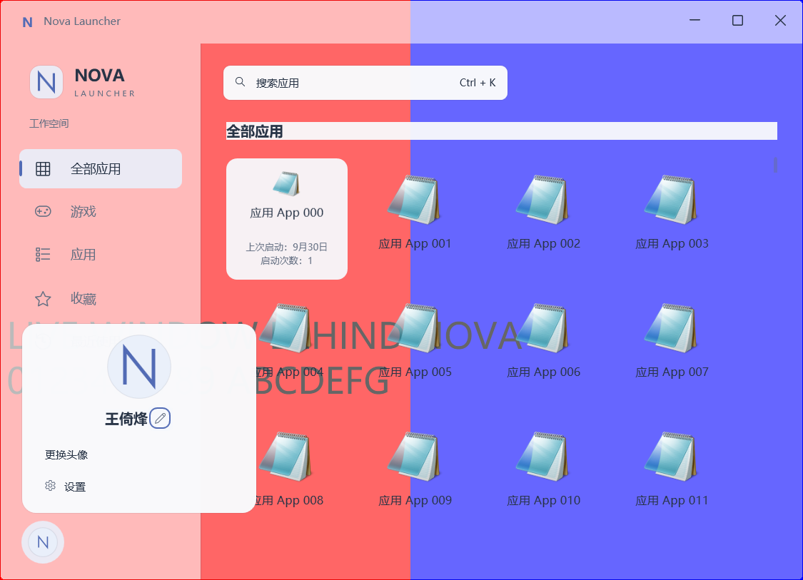

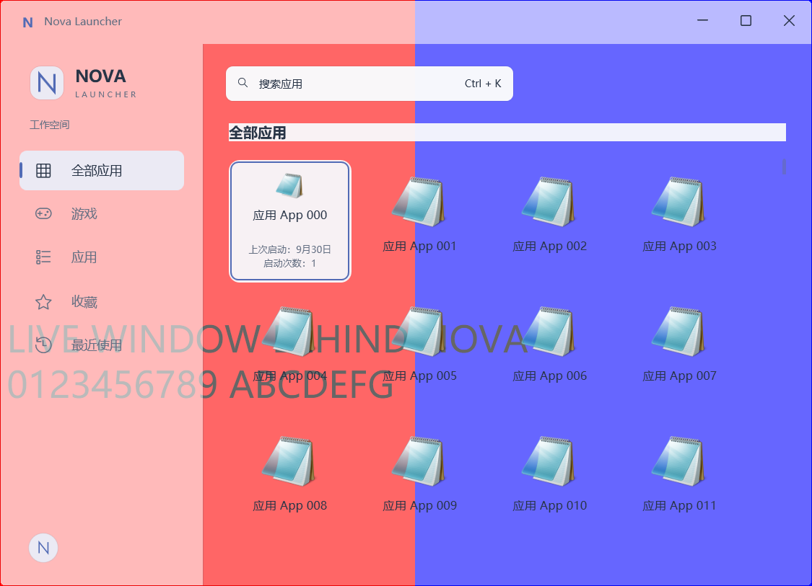

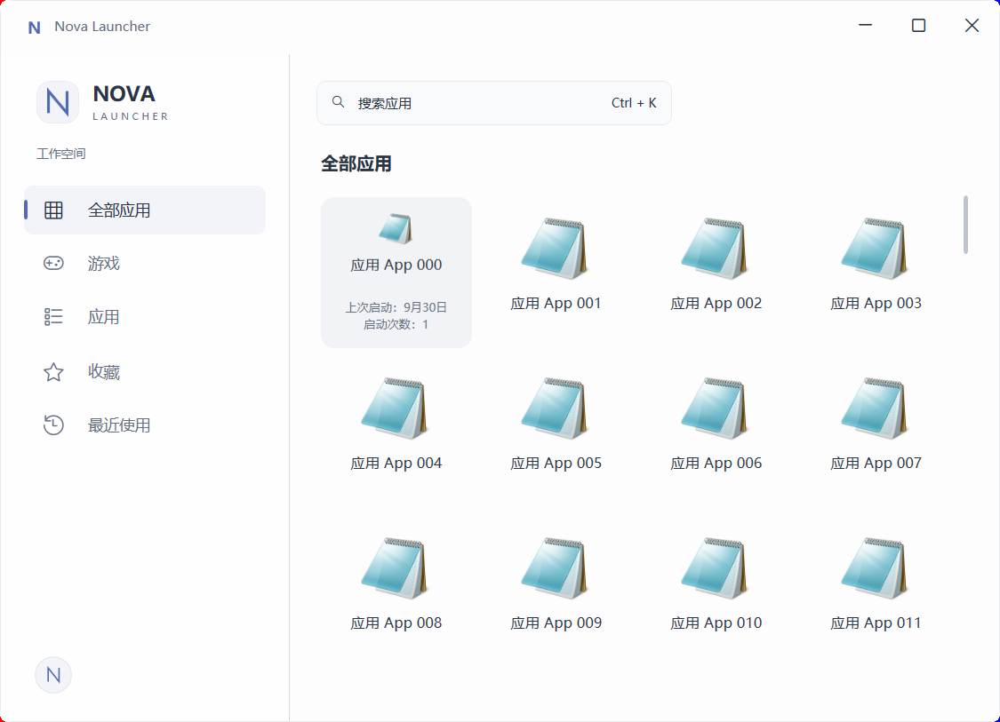

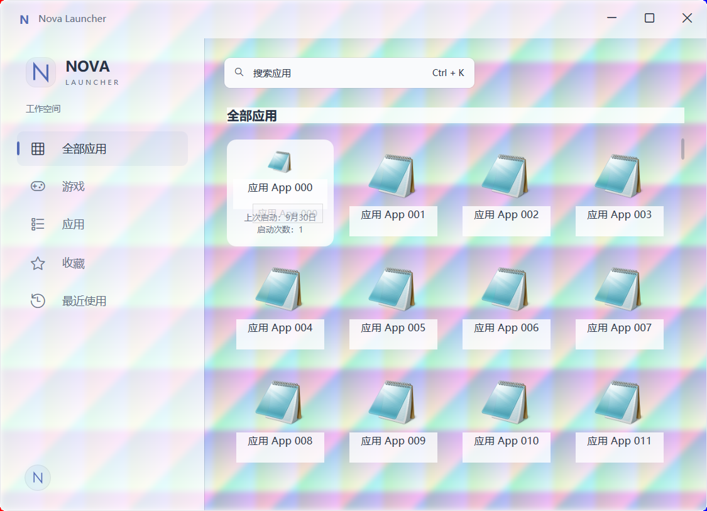

## 结论与定义

**True Transparency = ACHIEVED（本机实验模式）**：Windows逐像素窗口合成使Nova实时透出后方独立窗口。用红/蓝测试窗口验证Nova不动而后窗移动、后窗不动而Nova移动；同一背景采样点的COLORREF依次为`00FF6666 → 006666FF → 00FF6666`，不是壁纸替换或截图播放。测试中的GetPixel/屏幕截图只读最终合成结果，未参与产品渲染。

采用官方WPF `AllowsTransparency=True`、`WindowStyle=None`、透明Window背景；保持`Window.Opacity=1`。第一版提供透明加白色Tint，不提供Behind-Window Blur。模式标记为“透明桌面（实验性）”，不是跨所有硬件/系统的稳定性保证。未实施WinUI迁移、DirectComposition宿主、未公开DWM属性或AccentPolicy。

DesktopWallpaper仍是读取Windows静态壁纸文件；CustomImage仍是用户选择的图片；两者不属于True Transparency。Default、DesktopWallpaper、CustomImage均保留原图像管线。

## 旧DesktopBackdrop为何没有透出后窗

1. 正式ShellBackgroundView默认`SolidColor`，旧`DesktopBackdropController`不处于启用状态；正式DesktopWallpaper使用图像加载服务，不启动旧DWM实验。
2. 原MainWindow为普通非layered HWND，`AllowsTransparency=False`，WindowChrome初始GlassFrameThickness=0。仅把WPF Background设为Transparent不会保证桌面或其他窗口可见，Microsoft的AllowsTransparency说明明确区分这两件事。
3. 旧控制器会请求Desktop Acrylic（38/3）、全客户区frame=-1及透明CompositionTarget，但`IsBackdropActive`只表示请求返回成功。它还会因非活动窗口、系统策略等主动fallback；原生Tint为约85%白色，进一步掩盖变化。
4. 本机重新测试原路径、移除Shell不透明背景后的DWM None/Mica/Acrylic：API返回`S_OK`，采样仍分别为固定`F8F8F8`、`FFFFFF`、`F8F8F8`、`E5E5E5`，没有后窗运动响应。因此这些路径**在本机本WPF组合下未达成实时透视**。不能仅据HRESULT推断像素效果，也不能据此宣称Desktop Acrylic在所有平台都不支持后窗采样。

本机Windows 11 build 26200、系统EnableTransparency=1、缩放125%、WPF RenderTier=2；设备包含Intel UHD、RTX4060 Laptop及GameViewer Virtual Display Adapter。Tier是能力等级，不是每次绘制一定使用硬件的证明；没有把旧版WPF软件渲染限制直接套用于.NET9。

## 官方资料与技术路线

| 路线 | 实时后窗 | Blur | 性能/稳定性 | 复杂度与WPF兼容 | Windows范围 |
| --- | --- | --- | --- | --- | --- |
| A DWM System Backdrop | Mica不提供；Desktop Acrylic设计上支持，本机当前宿主实测未成功 | Acrylic系统模糊 | 系统策略会改变效果；成功返回不保证透视 | API少，但依赖HWND、alpha和Chrome共同配置 | SystemBackdrop枚举Win11 22621+ |
| B WPF AllowsTransparency | 本机动态测试成功 | 本方案无背景模糊 | 需评估layered窗口的渲染/复制开销；默认模式不使用 | 与现有WPF UI兼容，切换需要重建窗口宿主 | 技术支持早期Windows；本实验保守限制Win11 22621+ |
| C Win32 / DirectComposition | 可构建alpha合成宿主 | 需独立效果/采样管线，非自动附赠 | GPU合成能力强，但不能推断迁移后的实际收益 | 高；WPF HWND airspace、输入、DPI、Surface桥接需处理 | 依具体API与部署目标而定 |
| D Windows App SDK / WinUI 3 | DesktopAcrylic可以；Mica仍不可以 | 支持系统Acrylic | 官方材质与fallback；本轮未做WinUI实测 | 引入运行时/互操作或迁移，非WPF一行替换 | SDK与具体Backdrop各有版本条件 |
| E DesktopWallpaper | 不支持实时后窗 | 仅图片自身BlurEffect | 当前稳定实现 | 低，现有WPF图像管线 | 现有产品兼容范围 |

Mica/Mica Alt是不透明、以壁纸着色的材质。Background/Desktop Acrylic能采样桌面和其他窗口；In-app Acrylic只采样应用内，二者不能混称。WPF BlurEffect作用于本应用Visual，不是桌面后窗采样器；本轮不向Root Grid增加BlurEffect。

参考官方资料：

- [AllowsTransparency契约](https://learn.microsoft.com/en-us/dotnet/api/system.windows.window.allowstransparency?view=windowsdesktop-9.0)：透明Background与透明窗口的区别、WindowStyle=None要求。
- [DWM_SYSTEMBACKDROP_TYPE](https://learn.microsoft.com/en-us/windows/win32/api/dwmapi/ne-dwmapi-dwm_systembackdrop_type)：Mica、Desktop Acrylic、Mica Alt和最低系统版本。
- [Acrylic材质](https://learn.microsoft.com/en-us/windows/apps/design/style/acrylic)：Background与In-app采样对象、系统fallback。
- [DWM自定义frame](https://learn.microsoft.com/en-us/windows/win32/dwm/customframe)：全客户区frame与alpha像素要求。
- [WPF技术区域](https://learn.microsoft.com/en-us/dotnet/desktop/wpf/advanced/technology-regions-overview)：HWND airspace和layered窗口硬件支持。
- [Windows App SDK System Backdrops](https://learn.microsoft.com/en-us/windows/apps/develop/ui/system-backdrops)：官方WinUI材质接入方式，不是本轮已测试实现。
- [DirectComposition API](https://learn.microsoft.com/en-us/windows/win32/api/_directcomp/)：后续原生合成替代路线，本轮未引入。

## 实现

`BackgroundMode.Transparent`追加在既有枚举末尾，仍按字符串存储。GlassOverlay在Shell背景层绘制白色，Opacity复用`BackgroundOverlayOpacity`（20–95%，默认72%）；VM用GlassOverlayPercent表达UI语义，没有重复持久化字段。图像Blur和Stretch仅在图片模式显示。

Transparent窗口跳过旧DesktopBackdropController，避免其fallback把CompositionTarget重新涂成不透明。Sidebar、标题栏、标签底面与Settings Row保持不透明可读Surface；Quick Launcher、Context Menu、Profile沿用高不透明Surface。文字、图标和卡片不设置全局透明度。

WPF不能在已创建的HWND上更改AllowsTransparency，因此模式切换仅替换MainWindow宿主，共享原MainWindowViewModel和业务对象，不重新读取或重建应用数据。保留窗口正常位置/大小、状态、Sidebar宽度、当前导航以及外观展开/滚动状态；旧窗口解绑关闭流程后销毁。稳定模式恢复非layered HWND，避免永久承担透明路线开销。8.2首40、SystemIdle每20项、取消/退订机制不变。

能力检测包含Windows版本、DwmIsCompositionEnabled、HighContrast、RemoteSession及诊断禁用开关。入口不支持时显示“当前系统不支持实时透明背景”，回退Default。加载旧透明设置时同样检查；SQLite无法写回时仍在会话中回退。启动或宿主创建异常记录日志并停用本会话透明能力；已有窗口先恢复不透明Surface，避免不可操作。

`NOVA_DISABLE_TRANSPARENCY=1`为快速诊断关闭开关；通常直接在Settings选择默认即可。无新增依赖、Schema或Migration。app.manifest、拼音算法、业务Repository、单实例协议、日志架构和发布脚本未修改。

## 验证边界与已知限制

- 本机单显示器125%：动态像素、Tint、300应用、搜索、原生Shift+F10、Hover、窗口Resize/Maximize/Restore/Minimize和背景切换均检查。
- 用户确认没有多个不同DPI显示器；跨显示器和跨DPI移动**待人工验收**，不标记通过。
- 原生Alt+Tab切出/返回、Win+D显示桌面/恢复、Win+Left贴靠共5项检查通过；Win+Z的Snap Layout系统面板已从截图确认显示。长时间快速移动下的白闪/冻结仍待人工验收，以上结果不代表全部窗口组合与硬件环境通过。
- WindowChrome保留边缘命中和自定义标题栏。Layered窗口不保证普通DWM窗口同等阴影；未增加模拟DropShadow或未公开圆角属性来掩盖差异。
- Windows最大化窗口矩形可能延伸到屏幕外；全HWND截图的屏外黑色像素不等于屏幕内黑边。以可见屏幕区域复核，不凭截图边框断言全部环境通过。
- 本版无真实背景Blur。低Tint会显露复杂背景，建议从默认72%开始；浮层Surface不随Tint变透明。
- 真实Clean Machine Test继续未完成，是正式对外发布前Release Gate；Single-file仍仅部分验证。

人工复现：打开有明显文字的窗口置于Nova后方，启用透明桌面，固定Nova移动后窗，再固定后窗移动Nova；降低/提高玻璃遮罩，确认文字/图标不变透明。随后测试Alt+Tab、Win+D、Snap、跨屏/DPI及切回三种稳定背景。不得用只有壁纸的截图判定通过。

## 300应用性能实测

相同8.2隔离夹具、1200×720窗口、Release，每模式预热1次和正式5次，使用新进程与已预热的系统缓存。以下均为正式5次中位数；图片模式Blur=12。原始JSON位于`artifacts/verification/8.4/final-performance`。

| 指标 | Default | CustomImage | Transparent |
| --- | ---: | ---: | ---: |
| First Layout (ms) | 837.5 | 834.3 | 874.3 |
| Startup Ready (ms) | 3683.6 | 3827.2 | 3781.1 |
| All Cards Ready (ms) | 6659.9 | 6864.9 | 6833.8 |
| Scroll 30步 (ms) | 126.4 | 122.0 | 135.2 |
| Resize 20步 (ms) | 854.0 | 732.6 | 1147.2 |
| Scroll CPU (ms) | 281.25 | 234.375 | 234.375 |
| Resize CPU (ms) | 1078.125 | 1046.875 | 1187.5 |
| 全探针 CPU (ms) | 10031.25 | 10437.5 | 10437.5 |
| Managed Memory (bytes) | 131711568 | 131701832 | 131772280 |
| Working Set (MiB) | 580.6 | 679.7 | 597.2 |

Transparent相比同期Default：首屏+4.4%、Ready+2.6%、Scroll+7.0%、**Resize+34.3%**。首屏仍接近8.3的892ms级别，但Resize存在明显代价，因此保留实验性、默认关闭，不声称全部交互无性能回退。跨时段的历史892ms不能作为本次提升依据。15次正式测量均首批40、最终300；仅Transparent为layered窗口。首屏范围分别为773.8–860.0、780.0–896.5、829.3–979.4ms。

All Cards Ready包含首屏截图，不是纯渲染耗时；全探针CPU含截图和GC，不是CPU利用率。WPF Tier2表示硬件能力，不证明每帧使用硬件。

GPU另用每模式一次补充运行采样，不纳入上述时序。CIM按Nova进程筛选引擎，每时刻取单引擎最大利用率；每模式仅4个有效样本。Default均值/峰值1%/4%，CustomImage为3.25%/13%，Transparent为1.25%/3%，采集Error均为空。该稀疏观测不能代表总GPU或DWM合成成本，也不能证明透明没有GPU开销。原始文件为各模式`*-gpu.json`。

## 构建、回归与交付

| 检查 | 结果 | 证据（artifacts/verification/8.4下） |
| --- | --- | --- |
| 最终Release Build | 0 warnings / 0 errors | build-final.log |
| 既有20组自动回归 | 728项通过 | regression/*.log |
| 透明生产App专项 | 25项通过 | live.log |
| 原生系统窗口操作 | 5项通过；另视觉确认Win+Z | system.log、system/snap-layout-panel.png |
| Self-contained发布 | 成功 | publish.log |
| Self-contained实际EXE Smoke | 12项通过 | publish-smoke.log |

728项涵盖全部应用、分类、收藏、最近使用、Quick Launcher、拼音、应用管理、Profile、Settings、三种稳定背景、持久化、迁移兼容、单实例及日志。透明25项另覆盖真实300应用、后窗/Nova移动、Tint、Ctrl+K、Shift+F10、Hover、窗口状态、背景切换、宿主状态保留、不支持回退、保存失败回退及模型无变化。合计758项断言，另12项发布Smoke；原型仅记录观测，不算断言。已通过且未受后续改动影响的结果沿用，不重复运行。

0新增依赖、0 Schema Change、0 Migration；只有BackgroundMode枚举追加Transparent，Tint复用现有设置字段。未修改发布脚本或manifest。

主要交付仍为Self-contained win-x64 Portable Preview：`artifacts/publish/self-contained/NovaLauncher.exe`，版本`0.1.0-preview.1`。应保留同目录所有文件。Single-file仅部分验证；真实Clean Machine Test未完成，仍是正式对外发布前Release Gate。本轮不自动commit，等待用户验收。

复现入口（真实WPF操作需交互式桌面；数据根使用绝对路径及隔离验证标记）：

```powershell
dotnet build NovaLauncher.sln -c Release --no-restore
$verifier = '.\NovaLauncher.Verification\bin\Release\net9.0-windows\NovaLauncher.Verification.exe'
$data = Join-Path $PWD 'artifacts/verification/8.4/live-data'
& $verifier --transparency-prototype artifacts/verification/8.4/prototype
& $verifier --transparency-live $data artifacts/verification/8.4/live
& $verifier --transparency-system $data artifacts/verification/8.4/system
.\scripts\Test-TransparencyPerformance.ps1 -IncludeGpuSample
```

性能脚本要求已有8.2的fixture-300；每组结束后恢复该隔离夹具为Default。

## 截图证据

前三张按动态测试顺序排列，后方为带文字的独立红蓝测试窗口；采样结果与live.log相互印证。截图只用于验证输出，生产透明管线不捕获屏幕。

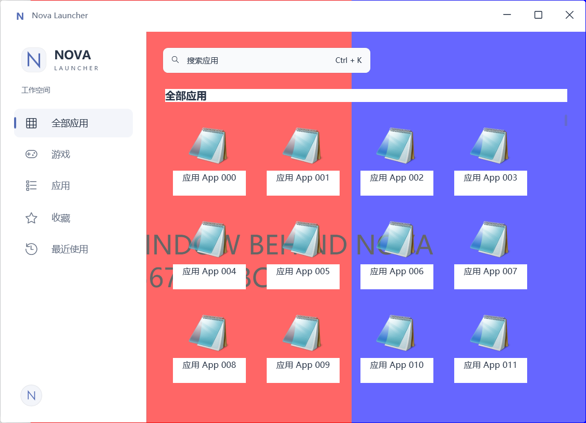

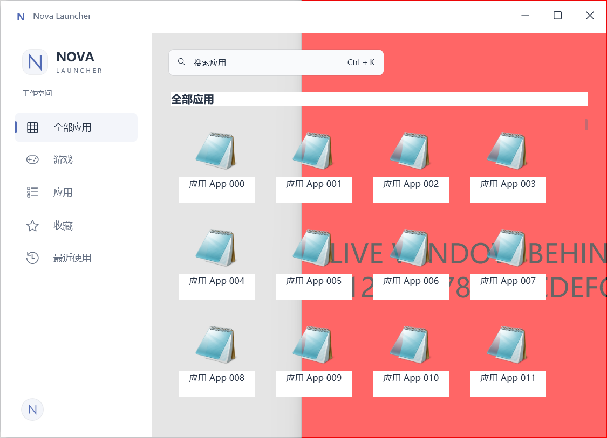

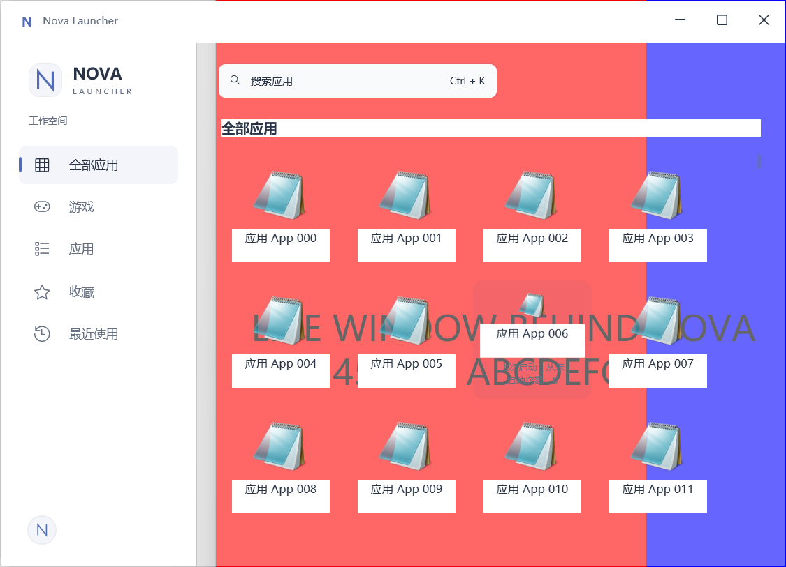

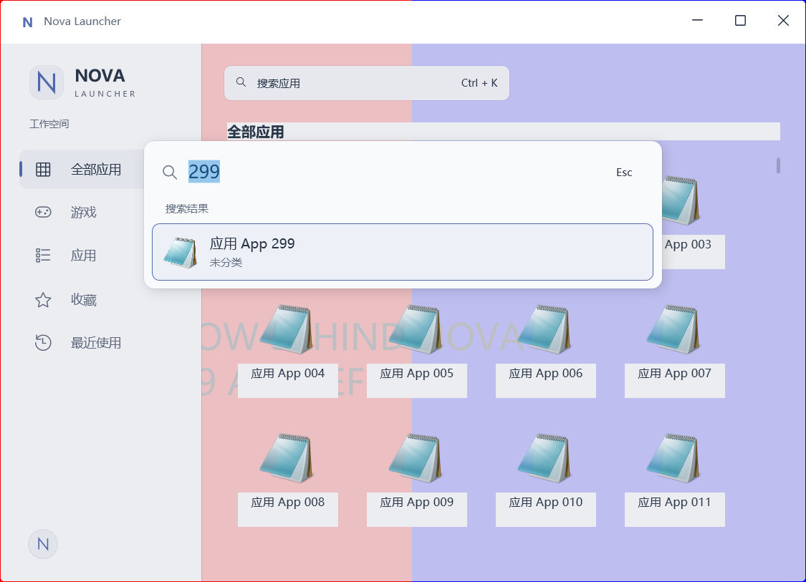

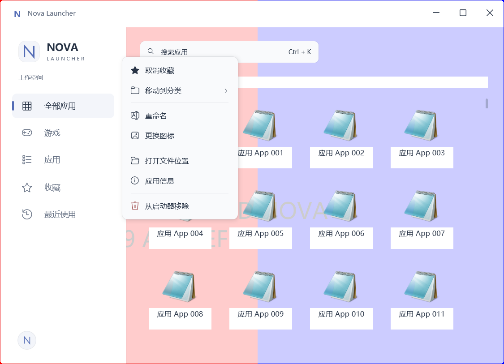

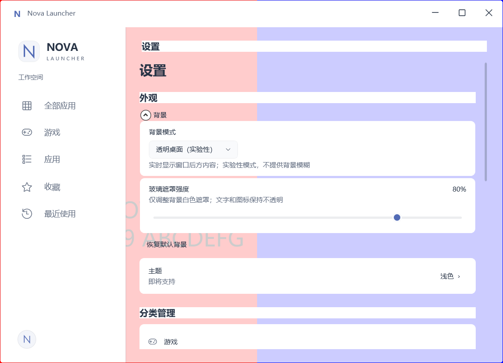

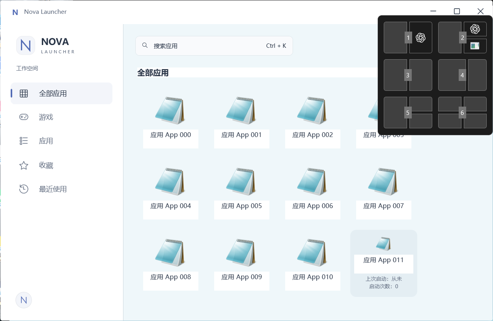
