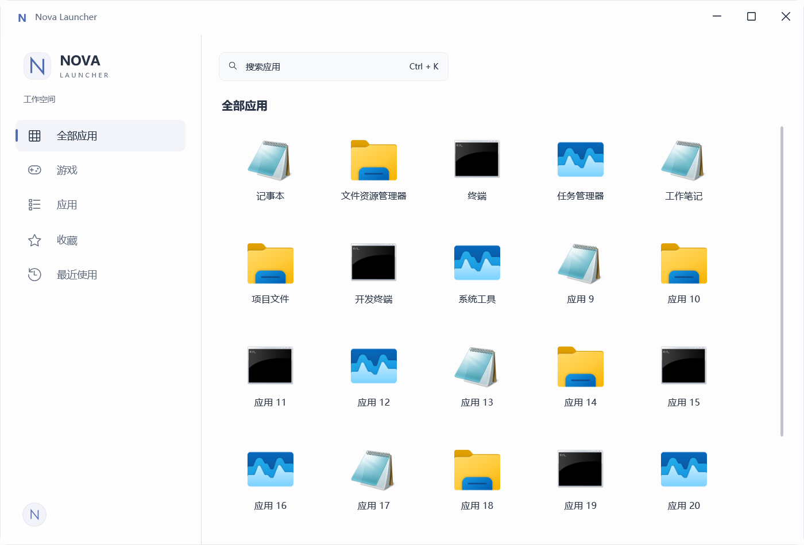
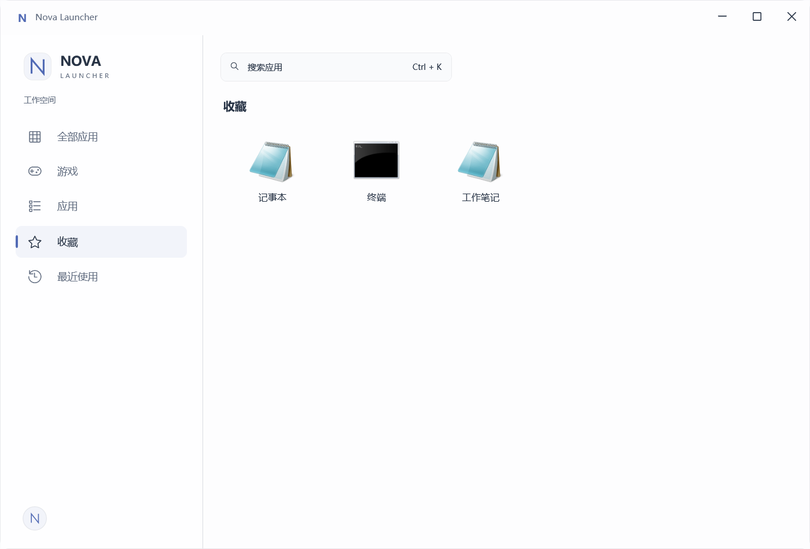
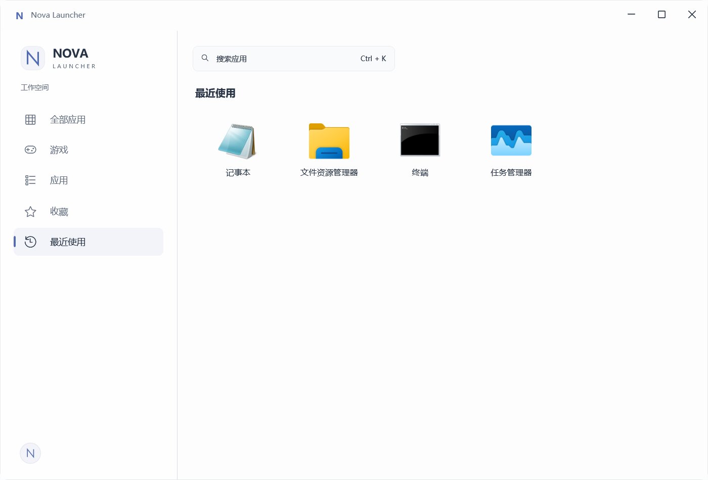
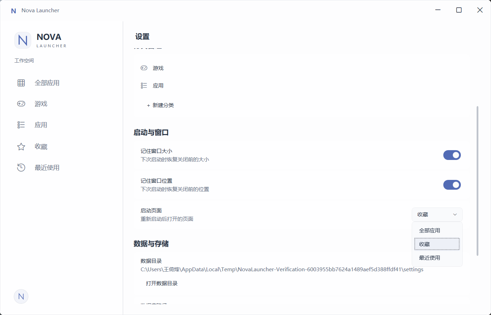

# Nova Launcher 8.3 — 主界面信息架构简化

基线：`b592964549e1ed2ab054cf4797504d8adc89a3ba`。本轮已通过最终验收，用户授权提交 `refactor: simplify launcher main navigation`；不开始8.4。

## 产品与架构

默认主页面为全部应用：原搜索入口 → 24 DIP → 全部应用标题 → 18 DIP → Application Grid。Workspace Padding仍为24 DIP，列表透明，卡片的尺寸、图标、Hover、启动和管理交互保持原设计，窗口标题仍为Nova Launcher。

Sidebar为Logo、工作空间、全部应用（Apps图标）、动态分类、收藏、最近使用、弹性留白、Profile头像。Settings仍由Profile Flyout进入。现有“应用”分类保留名称及Id；它与“全部应用”语义接近的问题记录于Product和Design，未修改用户分类。

`WorkspaceMode.Home`正式重命名为`AllApplications`。删除HomeViewModel、Recent/Favorite Top6 Dashboard投影、查看全部命令/事件/绑定和专用样式。HomeView改为AllApplicationsView，承载仍有职责的渐进呈现，直接使用ContentViewModel.Applications；没有新增AllApplicationsViewModel。分类、收藏、最近使用继续复用既有过滤集合，服务与Repository均保留。

持久化`StartupPage.Home`及字符串`Home`保持不变，映射到AllApplications；Settings显示“全部应用 / 收藏 / 最近使用”。旧值无需Migration，三个启动选项均经独立生产App进程验证。旧`HomeFirstLayout`诊断JSON键保留用于同协议性能比较，当前测量全部应用页面。

全部应用为空时隐藏标题，显示原始“+ / 请将文件拖拽至此 / 支持 .exe 和 .lnk”，搜索入口保留。收藏空状态为“还没有收藏应用 / 右键应用即可添加到收藏”。Recent维持LastLaunchTime DESC和原空状态。Quick Launcher不依赖已渲染卡片，打开、关闭或启动后保留当前页面。

## 渐进渲染与边界

超过100项时首批40项，DispatcherPriority.SystemIdle每批追加20项；100项以内直接展示完整集合。卸载与切换DataContext取消待执行批次并退订；重新进入建立稳定前缀。增删、移动、Reset按引用同步，重命名、图标、收藏、分类、启动统计继续通知共享卡片VM。

ScrollViewer内保留StackPanel包裹WrapPanel ItemsControl，维持滚动范围与自适应换行；不增加白色Surface。没有实现真正VirtualizingWrapPanel，最终仍创建300张卡片，不承诺滚动或Resize性能专项改善。

## 构建与回归

`dotnet build NovaLauncher.sln -c Release --no-restore`通过：**0 warnings / 0 errors**。日志：`artifacts/verification/8.3/build.log`。

**20组共728项主进程断言通过**，另含既有独立进程检查和新增三个启动选项进程检查；子进程内部断言不重复加入总数。

| 套件 | 断言 |
| --- | ---: |
| All Applications | 26 |
| Performance behavior | 13 |
| Settings | 44 |
| Categories | 34 |
| Favorites / Recent | 31 / 22 |
| Management / App edit | 46 / 59 |
| Quick Launcher / Pinyin | 69 / 123 |
| Appearance / Profile | 39 / 44 |
| Launch / Import | 32 / 37 |
| Persistence / Toast | 25 / 11 |
| Migrations / Release safety / Logging | 30 / 13 / 11 |

结果保存在`artifacts/verification/8.3/regression/*.log`。覆盖真实OLE拖放、原生右键和Shift+F10、收藏与Recent即时更新、重命名/图标/移除/分类、搜索与Ctrl+K、页面状态保持、Default/CustomImage/DesktopWallpaper、切页取消与旧视图回收。全程使用隔离测试数据，未运行真实用户数据验证入口。

移除Dashboard后更新旧测试的重复卡片数量预期；Polish夹具扩为24项以继续覆盖滚动条，滚动到顶部后等待布局再检查Hover。原生输入测试重新置前自己的窗口并等待焦点，仍保留命中保护，没有直接设置菜单打开来替代快捷键检查。已通过且未受后续修改影响的套件不重复执行。

Schema、Migration、依赖均零变化。没有修改拼音/Quick Launcher算法、Background实现、日志架构、SingleInstance或Publish流程。生产UI已无“首页”文案，历史阶段说明和稳定存储/诊断标识保留。

## 300应用性能

复用8.2隔离夹具、Release、相同1200×720窗口和探针协议；独立进程预热1次（run 0不计入统计），正式5次。未清空OS文件缓存，属于warm OS-cache / fresh process，不称严格冷启动。命令：

```powershell
./scripts/Test-Performance.ps1 -Label 8.3-after -Counts 300 -OutputDirectory artifacts/verification/8.3/performance
```

| 正式轮次 | First Layout (ms) | Startup Ready (ms) | All Cards Ready (ms) |
| --- | ---: | ---: | ---: |
| 1 | 789.4 | 3709.0 | 6575.1 |
| 2 | 832.8 | 3844.8 | 6811.1 |
| 3 | 909.7 | 3823.9 | 6727.0 |
| 4 | 892.0 | 3882.1 | 6882.9 |
| 5 | 953.4 | 3880.5 | 6775.2 |
| Median | **892.0** | **3844.8** | **6775.2** |

首屏布局较8.2的1103.4ms改善**19.2%**；Startup Ready较4012.5ms改善**4.2%**，本机测量没有明显回退。每轮均首批40、最终300张；8.2为首批52、最终312（含重复Dashboard卡片），卡片减少是本次产品调整的预期结果。预热布局974.2ms、Ready4449.3ms。

All Cards Ready含首屏截图开销，不能视作纯渲染时间；本轮中位数6.78秒，8.2约8.25秒。Scroll30Steps中位数112.4ms、Resize20Steps中位数627.6ms，仅作当前记录，不宣称解决滚动/Resize性能。JSON与首屏/全量截图位于`artifacts/verification/8.3/performance/`；历史测量边界见[Performance-8.2.md](Performance-8.2.md)。

## 截图

以下为真实WPF隔离夹具截图，均已检查。

### 全部应用



### 收藏



### 最近使用



### Settings启动选项



## 发布限制

已通过既有`Publish.ps1 -Mode SelfContained`刷新8.3交付，实际EXE位于`artifacts/publish/self-contained/NovaLauncher.exe`，压缩包为`artifacts/publish/NovaLauncher-0.1.0-preview.1-win-x64-self-contained.zip`。未改版本或发布脚本。实际复制后的Portable包通过12项Smoke检查（不计入728项）：无数据库/日志/PDB载荷、隔离SQLite启动、加载自带runtime、第二实例唤醒、异常结束后重启、真实OLE导入与启动探针、分类/收藏/Recent、重命名与拼音搜索、图标/Profile/背景、重启恢复、真实用户目录元数据不变。日志位于`artifacts/verification/8.3/publish-smoke.log`。

真实Clean Machine Test仍未执行，继续作为正式对外发布前Release Gate。主要交付形式仍为Self-contained win-x64 Portable Preview；Single-file仅启动范围部分验证，不作为主要交付方式。

## 最终收尾（2026-10-21）

再次Release构建通过：0 warnings / 0 errors，日志为 artifacts/verification/8.3/build-closeout.log。业务实现未再修改，复核并沿用728项自动回归、12项Self-contained Smoke和五次正式性能测量结果，不重复执行已通过测试。确认本次提交没有Schema、Migration、新依赖或无关修改。
